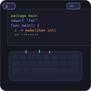

<!-- Visitor Counter & Dynamic Status Badges -->

  
  
  

<!-- Animated Cyber Aesthetic Hero Header GIF -->

  

<!-- Dynamic Typewriter Animation -->
<h1 align="center">
  
</h1>

<!-- Quick Connect Social Dock -->

  
  
  
  
  

<!-- Animated Glowing Line Divider -->

 

<!-- ========================================================================= -->
<!-- 02. BENTO TECH ARSENAL -->
<!-- ========================================================================= -->

## 🛠️ Tech Arsenal & Systems Matrix

  Carefully selected production technologies utilized across the software development lifecycle:

<!-- Dynamic Animated Skill Icons Matrix -->

  

<table border="0" width="100%" cellpadding="6" cellspacing="0">
  <tr>
    <td width="50%" valign="top">
      <h4>💻 Languages & Runtime Core</h4>
      

        
        
        
        
        
        
      

      <h4>⚙️ Backend & Distributed Architecture</h4>
      

        
        
        
        
      

    </td>
    <td width="50%" valign="top">
      <h4>☁️ Cloud, DevOps & Orchestration</h4>
      

        
        
        
        
        
        
      

      <h4>🗄️ Persistence, Caching & Frontend</h4>
      

        
        
        
        
        
        
      

    </td>
  </tr>
</table>

 

<!-- ========================================================================= -->
<!-- 03. AUTOMATED DEVOPS CI/CD WORKFLOW PIPELINE -->
<!-- ========================================================================= -->

## 🔄 Cloud-Native Delivery & CI/CD Pipeline

  

  <code>Git Commit / Push</code> ➔ 
  <code>Automated Tests & Lint</code> ➔ 
  <code>Docker Multi-Stage Build</code> ➔ 
  <code>K8s Rolling Deployment</code> ➔ 
  <code>Telemetry & Health Probes</code>

 

  

<!-- ========================================================================= -->
<!-- 04. FEATURED OPEN SOURCE PROJECTS -->
<!-- ========================================================================= -->

## 🚀 Flagship Engineering Projects

<table border="0" width="100%" cellpadding="0" cellspacing="0">
  <tr>
    <td width="49%" align="center" valign="top">
      
      

        <b>🛡️ LinkedAudit:</b> AI-assisted career profile audit system providing automated diagnostics, profile scoring, and resume optimization heuristics.
      

    </td>
    <td width="2%"></td>
    <td width="49%" align="center" valign="top">
      
      

        <b>⚡ Pyrynx:</b> Modular asynchronous service scaffolding and utility engine engineered for lightweight, fast execution pipelines.
      

    </td>
  </tr>
  <tr>
    <td width="49%" align="center" valign="top">
      
      

        <b>🤖 AI-CareerForge:</b> Intelligent career acceleration roadmap engine matching developer competencies with industry role benchmarks.
      

    </td>
    <td width="2%"></td>
    <td width="49%" align="center" valign="top">
      
      

        <b>📊 CGPA Analytics Engine:</b> Robust multi-semester grade and performance evaluation calculator featuring instant analytics and trend forecasting.
      

    </td>
  </tr>
</table>

 

  

<!-- ========================================================================= -->
<!-- 05. LIVE TELEMETRY & GITHUB ANALYTICS -->
<!-- ========================================================================= -->

## 📊 Live GitHub Telemetry & Productivity

<table border="0" width="100%" cellpadding="0" cellspacing="0">
  <tr>
    <td width="49%" align="center" valign="middle">
      
    </td>
    <td width="2%"></td>
    <td width="49%" align="center" valign="middle">
      
    </td>
  </tr>
</table>

 

<table border="0" width="100%" cellpadding="0" cellspacing="0">
  <tr>
    <td align="center" valign="middle">
      
    </td>
  </tr>
</table>

<!-- Interactive Activity Graph -->
### 📈 Real-Time Commit & Activity Frequency

  

<!-- Platane Contribution Snake Animation -->
### 🐍 Contribution Grid Eater

  <picture>
    <source media="(prefers-color-scheme: dark)" srcset="https://raw.githubusercontent.com/KalaiScript/KalaiScript/output/github-contribution-grid-snake-dark.svg">
    <source media="(prefers-color-scheme: light)" srcset="https://raw.githubusercontent.com/KalaiScript/KalaiScript/output/github-contribution-grid-snake.svg">
    
  </picture>

 

  

<!-- ========================================================================= -->
<!-- 06. COMPETITIVE CODING, HONORS & CERTIFICATIONS -->
<!-- ========================================================================= -->

## 🏆 Engineering Honors & Problem Solving

<table border="0" width="100%" cellpadding="4" cellspacing="0">
  <tr>
    <td width="55%" valign="top">
      <h4>🎯 Problem Solving Platforms</h4>
      
Continuous algorithmic drill and optimization across competitive hubs:

      

        
        &nbsp;
        
        &nbsp;
        
      

      <h4>🏅 GitHub Milestones</h4>
      <ul>
        <li>🦈 <b>Pull Shark:</b> Continuous code reviews and multi-service pull requests.</li>
        <li>🎯 <b>Quickdraw:</b> Swift response and fast-cycle issue triage.</li>
        <li>⚡ <b>Hackathon Finalist:</b> Engineered end-to-end GraphRAG inference application.</li>
        <li>🌟 <b>Open-Source Builder:</b> Actively creating re-usable backend modules and dev tools.</li>
      </ul>
    </td>
    <td width="45%" align="center" valign="middle">
      
    </td>
  </tr>
</table>

 

  
<b>📜 Click to view Verified Industry Certifications</b>

   
  <table border="0" width="100%" cellpadding="6" cellspacing="0">
    <tr>
      <td width="60%" valign="middle">
        <ul>
          <li>🏷️ <b>AWS Certified Solutions Architect (Associate)</b> — Amazon Web Services</li>
          <li>🏷️ <b>Google Cloud Digital Leader</b> — Google Cloud Platform</li>
          <li>🏷️ <b>HashiCorp Certified: Terraform Associate</b> — HashiCorp</li>
          <li>🏷️ <b>Advanced Go Programming Patterns</b> — Tech Academy</li>
        </ul>
      </td>
      <td width="40%" align="center" valign="middle">
        
      </td>
    </tr>
  </table>

 

  

<!-- ========================================================================= -->
<!-- 07. INSPIRATION & AUDIO WAVE -->
<!-- ========================================================================= -->

<table border="0" width="100%" cellpadding="0" cellspacing="0">
  <tr>
    <td width="50%" align="center" valign="middle">
      
    </td>
    <td width="50%" align="center" valign="middle">
      

        <h4>🎧 Deep Focus Frequency</h4>
        
<i>"Flow state unlocked • Compiling ideas into production systems"</i>

        
      

    </td>
  </tr>
</table>

 

<!-- ========================================================================= -->
<!-- 08. CONTACT & FOOTER DOCK -->
<!-- ========================================================================= -->

<table border="0" width="100%" cellpadding="8" cellspacing="0">
  <tr>
    <td width="30%" align="center" valign="middle">
      
    </td>
    <td width="70%" valign="middle">
      <h3>🤝 Let's Architect Something Extraordinary</h3>
      

        I am always open to discussing distributed system architectures, high-performance backends, open-source initiatives, or engineering roles. Let's start a conversation!
      

      

        
        &nbsp;&nbsp;
        
      

    </td>
  </tr>
</table>

 

  

    
  

  ⚡ Engineered with high precision by <a href="https://github.com/KalaiScript"><b>Kalaiyarasan (KalaiScript)</b></a> • Built for scale

